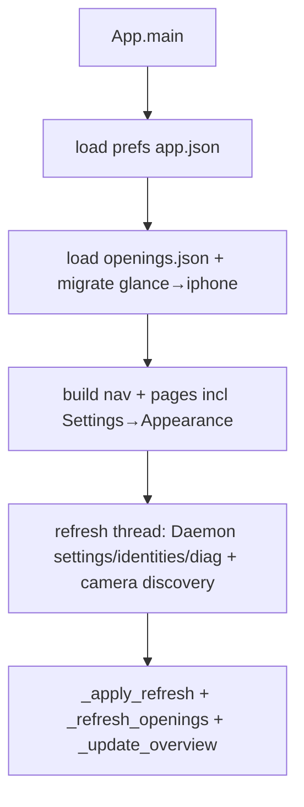
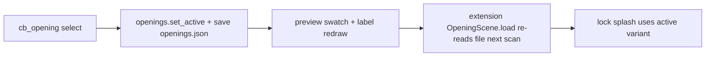
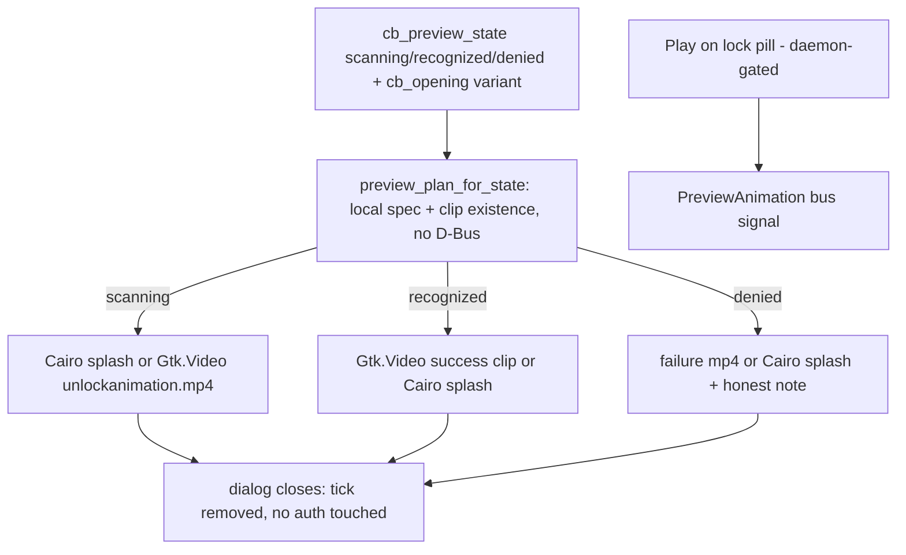
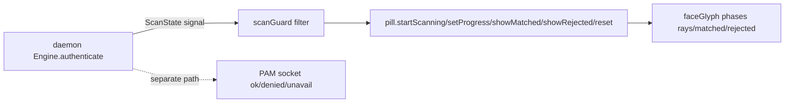

# Animation preview & runtime pipeline

File paths are source-tree paths. There is **no WebKit/HTML preview**:
the app previews with Cairo (`Gtk.DrawingArea`) + `Gtk.Video`, the
lock screen renders with Clutter/Cairo (`St.DrawingArea` + PNG frame
flips). No second renderer was introduced — the existing one was
repaired (Phase 3 rule: repair, don't parallel-build).

## Canonical states

Presentation-only names used in the app (`app/faceid_app/main.py`,
`PREVIEW_STATES`):

| Canonical | Meaning | App preview | Lock screen |
|---|---|---|---|
| `scanning` | auth in progress | opening splash (Cairo) or `unlockanimation.mp4` still | `opening.js` splash → glyph `rays` |
| `recognized` | daemon reported success | success clip (`unlockanimation.mp4`) or Cairo splash — daemon-free | glyph `matched` green + success card |
| `denied` | daemon reported failure | failure clip or Cairo splash — daemon-free | glyph `rejected` red + shake + failure card |

Settings previews resolve via `preview_plan_for_state()` from local
files only and work with `faceid-nimd` stopped. The separate "Play on
the lock pill" action is the one path that genuinely needs the daemon
(`PreviewAnimation` → canned `ScanState`); when the name
`org.faceidnim.Daemon1` is absent it shows an actionable
`daemon_down_message()` (`sudo systemctl start faceid-nimd`) and never
implies readiness.

Authoritative bus signals map onto them (`SCAN_STATE_TO_PREVIEW`,
`canonical_preview_state()`):

- `waking`/`searching`/`verifying` → `scanning`
- `matched` → `recognized`
- `rejected`/`timeout`/`camera_error` → `denied`
- unknown/empty → `scanning` (never a fabricated success)

Daemon `ScanState` values are defined in `daemon/src/dbus.rs`
(`waking|searching|verifying|matched|rejected|timeout|camera_error`);
the extension filters them in `shell-ext/faceid@nim/scanGuard.js`
(stale opposite terminal <3 s dropped) before `pill.js` acts.

## A. Startup pipeline

## B. Animation configuration pipeline

Persisted in `~/.config/faceid-nim/openings.json`
(`{active, variants, scan_face}`); `scan_face` values are
`apple|arena|classic` (UI labels Smile/Orbit/Classic never persist).
Legacy `glance` migrates to `iphone` on load.

## C. Animation preview pipeline

Note: no D-Bus activation file ships for `org.faceidnim.Daemon1`
(only the policy `packaging/dbus/org.faceidnim.Daemon1.conf` plus the
`faceid-nimd.service` systemd unit), so the bus name exists only while
the unit runs. `ServiceUnknown` therefore means "unit not
running/installed" — a startup/packaging state, not a bus misconfig —
and the Settings clip previews deliberately do not depend on it.

Variant-to-asset is explicit (`openings.GLANCE_CLIPS`,
`glance_asset()`), never filename guessing: the preview resolves the
**selected** variant's own clip. Missing mp4/codec → toast + settled
Cairo frame, never a crash. Rapid changes are safe: the inline dialog
owns one tick at a time, removed on `response`; the shell pill owns one
16 ms clock.

## D. Authentication visual-state pipeline

The animation is state-only: `dbusClient.js` calls no methods
(`shell-ext/check-listen-only.sh` enforces this in CI). Preview
controls (`_preview_success`, `_preview_denied`,
`_preview_opening_inline`) never invoke auth; `PreviewAnimation` only
emits canned `ScanState` for pill tuning.

## E. Installation & update pipeline

GitHub repo browsing ≠ release checking ≠ installation. The app has a
sidebar `GitHub ↗` link (`open_url()` via
`Gio.AppInfo.launch_default_for_uri`, no startup network) and a
community catalogue fetch on demand only. There is **no automatic
update checker** (deferred by design — see README): releases are built
by `release.yml` on `v*` tags into `.deb` assets; `install.sh` picks
the arch artifact; `postinst` fetches models and auto-detects cameras.

## Video format & sizing

- Source clips: `linux-anim/glance_anim/assets/` — 432×432 H.264,
  60 fps (`unlockanimation.mp4` success, `unsuccessfulunlockanimation.mp4`
  failure, `unlockstatic.png` idle). Lock screen plays 216×216 RGB PNG
  frames (`shell-ext/faceid@nim/glance-frames/`, 30 fps) extracted by
  `packaging/scripts/extract-glance-frames` (success clip only by design;
  denied is glyph-only on the lock screen).
- App inline preview letterboxes the 432×432 clip in a 280×200 `Gtk.Video`
  frame (aspect preserved, neutral dialog background, no stretch/crop).
  Missing codec/file → toast + Cairo fallback.
- Custom `.faceopen` packages hold colours + one `logo.svg|logo.png`
  only (≤2 MiB / ≤20 files, traversal/encryption/size guarded);
  `preview.svg` is **not** a supported field (README/docs corrected).
  Overwriting an existing id requires explicit Replace confirmation.

## Legitimate transitions (tested)

scanning → recognized, scanning → denied, terminal → scanning on a new
attempt; stale opposite terminals <3 s dropped; duplicates harmless;
missing/malformed assets fall back with a message.
See `app/tests/test_ui_animation_wiring.py`,
`app/tests/test_openings.py`, `shell-ext/tests/test-scan-guard.mjs`.
